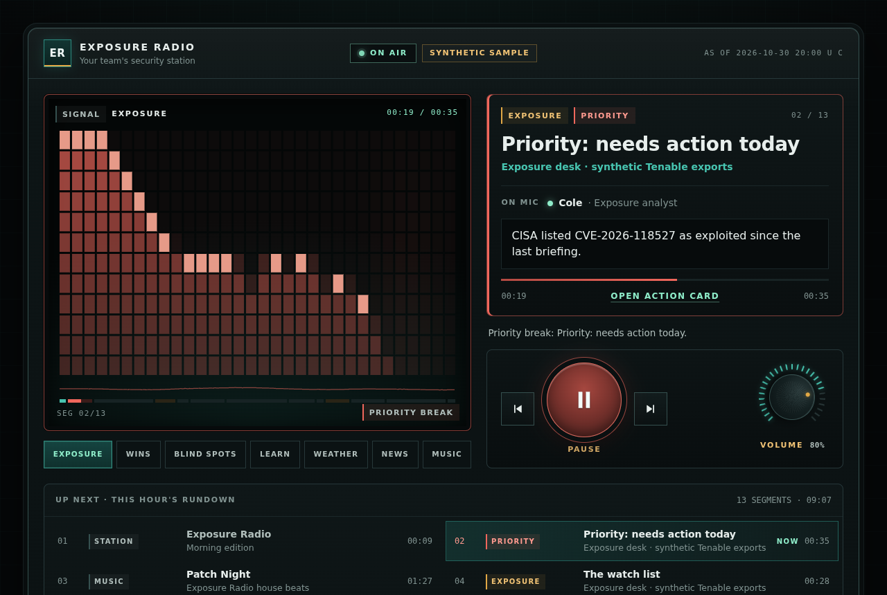
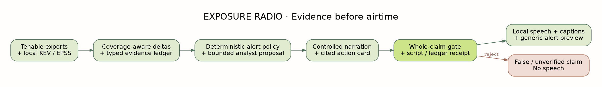

<p align="center"></p>

<h1 align="center">Exposure Radio</h1>

<p align="center"><b>Your Tenable findings, read aloud as a morning radio show for small IT teams. Every spoken fact is checked against the scan data before it is voiced.</b></p>

Exposure Radio compares **yesterday's Tenable scan with today's** and tells the team what changed: the one item to fix today, what is new, and what a rescan proved fixed. Two hosts, Avery and Cole, read it between weather, CISA and Cloudflare news, short Learn segments and music. If a vulnerability on CISA's known-exploited list shows up on one of your machines, it interrupts the music.

**Why two exports?** A change briefing needs a before and an after. Exposure Radio takes two Tenable Vulnerability Management exports, the previous scan and the current one, and diffs them. A finding only counts as *fixed* when the current export is complete and a rescan confirmed it, so a finding that simply disappeared is reported as *unverified*. With a Tenable API key, `station pull` fetches each export for you.



[Open the listener](web/index.html) · [Station console](web/admin.html) · [Operational use cases](docs/USE-CASES.md) · [Tenable segments](docs/TENABLE-SEGMENTS.md) · [Google, bring your own](docs/GOOGLE.md) · [Evidence and claim gate](web/briefing.html)

## Run it in two minutes

Python 3.10+ only. The station, the console, the demo and the MCP server use the standard library.

```bash
git clone https://github.com/Agent9AI/exposure-radio
cd exposure-radio
python3 -m exposure_radio station serve
```

Open **http://127.0.0.1:8080**, press **Tune in**, and the sample hour plays: exposure
briefings, weather, news, Learn and house beats, all pre-rendered, no key required. The
console at `/admin.html` uses the admin token the host prints at start.

## What's on air

| Segment | What the team hears | Source |
|---|---|---|
| **Priority** | One item that needs action today, and the next step | Two Tenable VM exports + CISA KEV |
| **Watch list** | What moved since the last scan, new exposure before new visibility | Tenable VM + FIRST EPSS |
| **Wins** | Findings verified fixed by a rescan | Tenable VM |
| **Blind spots** | Missed scans, lost credentials, newly visible machines | Tenable VM |
| **Weather and local** | Forecast and active alerts for the station's address | National Weather Service (keyless) |
| **Security news** | CISA exploited-list additions and active Zero Wire briefings | CISA + Cloudflare Radar |
| **Learn** | Sixty-second explainers: EPSS, KEV, exposure versus visibility | Bundled topics, or Gemini suggestions you approve |
| **Music** | Original house beats; your own YouTube playlists or Lyria tracks if connected | MIT-licensed `scripts/make_beats.py` |

Why these Tenable segments keep a small team on the same page:
[docs/TENABLE-SEGMENTS.md](docs/TENABLE-SEGMENTS.md).

## Operational use cases

| Workflow | Who it serves | How it runs | Guarantee |
|---|---|---|---|
| **1. 9:00 AM Zero-Meeting Standup** | Small IT & lean SecOps (2–15 engineers) | Schedule `station pull` + `brief` after the overnight Tenable scan; press **Tune In** | Separates *new exposure* on existing hosts from *new visibility* on newly scanned hosts |
| **2. CISA KEV & Zero Wire Break-In** | Vulnerability & patch owners | Deterministic `BREAK_IN` policy interrupts music on newly exposed KEV findings | SQLite alert memory stays `SILENT` on unchanged evidence; local Zero Wire caveats |
| **3. Claude Code & MCP Triage** | Security engineers & incident responders | `.mcp.json` loads 4 read-only tools + `/exposure-briefing` skill | Every factual sentence passes `check_claims` before output (`27/27` false claims blocked) |
| **4. Executive vs. Analyst Handoff** | CISOs, IT directors, MSP account leads | `--edition executive` for leadership audio/card; `--edition analyst` for ticket tables | Fail-closed audit across `304` tenant identifiers (`0` hostnames, FQDNs, IPs, or UUIDs leaked) |
| **5. Scanner Hygiene & Blind Spots** | Platform & scanner administrators | Coverage-aware delta checks `export-status.json` (`FINISHED`) and credentialed state | Incomplete exports confirm zero fixes; disappeared findings without a rescan are *unverified* |
| **6. SOC / NOC Ambient Wallboard** | 24/7 operations desks & shift handovers | Loopback or SSO-fronted station with console queue, Learn rotation, and quiet hours | Zero third-party trackers; keys stay mode `0600` on the station host |

Full workflow recipes, commands, and deployment patterns: **[docs/USE-CASES.md](docs/USE-CASES.md)**.

## Connect your own services

Everything optional is bring-your-own. The project ships no keys and no shared quota.

```bash
python3 -m exposure_radio station keys set tenable   # read-only VM export access
python3 -m exposure_radio station pull               # one complete export, loader-ready
python3 -m exposure_radio station keys set gemini    # broadcast voices, Learn suggestions
```

Keys live in a private settings file on the station host (mode 600). The browser console
only ever learns *whether* a key is set. Gemini's free tier may use content to improve
Google products, so exposure segments stay on local voices unless you mark the Gemini
project as paid. A Google AI Pro subscription's monthly Cloud credit can pay for that:
[step-by-step setup](docs/GOOGLE.md#using-a-google-ai-pro-subscription).

YouTube plays only in the official embedded player, with the video visible. The station
never downloads or strips YouTube audio.

## Hosts that sound like colleagues

The hosts say "the Ivanti Connect Secure flaw is open on one asset", not a CVE number
read digit by digit. Identifiers, owners and deadlines are on screen and on the action
card, where they can be copied into a ticket.

Tenant speech is evidence-bound. Each exposure line is a fixed rendition of a template
sentence, rebuilt from the evidence ledger and compared word for word before any voice
engine runs. The caption under it is the canonical sentence, and that caption passes the
claim gate:

1. Exports and public feeds produce typed `(subject, predicate, value, source)` facts.
2. Every caption is template output, parsed back into claims and checked against the ledger.
3. Every spoken line is rebuilt from the same template and values; one changed word refuses the segment.
4. Connective lines ("Cole, what are we looking at?") come from a fixed list and may not contain numbers or identifiers.
5. The audio renderer repeats the check immediately before text-to-speech.

`make gate-demo` rejects **27 of 27 adversarial statements** and accepts five true
controls. `tests/test_station.py` covers spoken-line drift, false captions, unknown
connective lines, key masking, admin-token enforcement and host-header checks.

## Build your own station hour

```bash
# Kokoro voices (local, free): pip install kokoro-onnx numpy soundfile, plus FFmpeg
python3 scripts/make_beats.py --out web/station/music
python3 scripts/build_station.py --model kokoro-v1.0.onnx --voices voices-v1.0.bin \
  --address "1600 Pennsylvania Ave NW, Washington, DC 20500"
```

`--offline` replays the saved weather and news snapshots. `--plan-only` writes the rundown
without audio. The data contract the listener reads is in [docs/STATION.md](docs/STATION.md).

## Use your own Tenable exports directly

```bash
python3 -m exposure_radio brief --prev exports/day1 --curr exports/day2 \
  --kev feeds/kev-current.json --prev-kev feeds/kev-previous.json \
  --epss feeds/epss.csv.gz --state private-state.sqlite3 --out private-brief
```

Each export directory holds `export-status.json`, `assets.json` and `vulns/chunk-N.json`,
exactly what `station pull` writes. Incomplete evidence confirms no fixes.

## Agents and MCP

An optional bounded analyst reads allowlisted facts through `list_candidates`, `get_facts`
and `check_claims`, then submits a ranked rundown. Code keeps the interruption decision.
The model cannot write remediation state or put free text into speech.
`python3 -m exposure_radio demo --analyst replay` replays a recorded run;
`--analyst anthropic` uses your own key.

`python3 -m exposure_radio mcp` exposes four read-only tools: `exposure_briefing`,
`check_claims`, `remediation_packet` and `explain_priority`.

### Ask Claude about your exposure

Open the clone in Claude Code and the read-only MCP server loads from `.mcp.json`
(approve it once). The bundled `exposure-briefing` skill makes Claude answer the way the
hosts do: brief from the ledger, run every factual sentence through `check_claims`,
and keep only what the evidence supports.

```bash
cd exposure-radio && claude
> /exposure-briefing what should we fix first today, and why?
```

Elsewhere: `claude mcp add exposure-radio -- python3 -m exposure_radio mcp`, run from the clone.

## Architecture & repository layout



| Path | Responsibility |
|---|---|
| `exposure_radio/delta.py`, `ledger.py` | Coverage-aware Tenable VM export diffing and typed `(subject, predicate, value, source)` evidence ledger |
| `exposure_radio/claims.py`, `gate.py`, `onair.py` | Controlled narration grammar (34 templates), reverse claim parser, and pre-speech script gate ([ADR-0001](docs/adr/0001-verified-claims-before-speech.md)) |
| `exposure_radio/policy.py`, `rundown.py` | Deterministic `BREAK_IN` / `HEALTH` / `SCHEDULED` / `SILENT` policy, SQLite alert memory, and fail-closed redaction |
| `exposure_radio/desks.py`, `zero_wire.py`, `tenable_api.py` | NWS weather, CISA KEV, Cloudflare Radar Zero Wire public context, and read-only Tenable VM export client |
| `exposure_radio/station.py`, `mcp_server.py`, `analyst.py` | Loopback station host (`mode 0600` key store), read-only stdio MCP server, and bounded analyst adapter |
| `web/index.html`, `web/admin.html`, `web/briefing.html` | Station listener, operator console, and interactive evidence & claim-gate inspector |
| `docs/USE-CASES.md`, `CONTRIBUTING.md`, `SECURITY.md` | Operational workflow recipes, contributor verification guide, and security boundaries |

## Verification

```bash
make check            # unit tests, adversarial gate demo, identifier audit
```

See [operational use cases](docs/USE-CASES.md), [contributing guide](CONTRIBUTING.md), [security boundaries](SECURITY.md), [build evidence](docs/BUILDLOG.md) and
[third-party notices](THIRD_PARTY_NOTICES.md). All tenant data in the sample is synthetic.

MIT licensed.

## Zero Wire public context

Cloudflare Zero Wire is connected without an account or API key. The news desk
reads active public briefings alongside CISA KEV; its drawer includes the briefing
summary, Cloudflare product-coverage caveats and source link. Open action cards
receive context only for an exact CVE match, joined locally. Zero Wire never
changes KEV membership, priority, verified-fix status or tenant narration.
No tenant CVEs are sent to Cloudflare. Agent assessment prompts remain links for
operator review and are never executed by the station.

Public feeds are fetched only while building an edition. The bundled snapshot
and audio work offline; the drawer shows the retrieval time. Rebuild with
`python3 scripts/build_station.py --offline --model MODEL --voices VOICES`
to replay that snapshot. Omit `--offline` to refresh public data.
Use `--only seg-08` to revoice the news desk while preserving hash-checked,
unchanged scripts and audio in the other segments.

The built-in HTTP station is intended for loopback use. Its optional LAN mode
has no TLS and is suitable only inside an independently secured transport;
settings are readable to listeners. Do not publish the admin console or use
real tenant data on an unsecured LAN.
