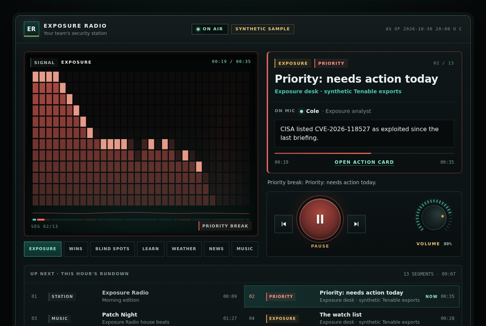

# Exposure Radio

**A security radio station for small IT teams.** Two hosts tell your team what changed in
Tenable overnight, what to fix first, and what was verified fixed, between weather, CISA
news, short Learn segments and music. Anything on CISA's exploited list that lands on one of
your machines interrupts the music.



[Open the listener](web/index.html) · [Station console](web/admin.html) · [Tenable segments](docs/TENABLE-SEGMENTS.md) · [Google, bring your own](docs/GOOGLE.md) · [Evidence and claim gate](web/briefing.html)

## Run it in two minutes

Python 3.10+ only. The station, the console, the demo and the MCP server use the standard library.

```bash
git clone https://github.com/Agent9AI/exposure-radio
cd exposure-radio
python3 -m exposure_radio station serve
```

Open **http://127.0.0.1:8080**, press **Tune in**, and the sample hour plays: exposure
briefings, weather, news, Learn and house beats, all pre-rendered, no key required. The
console at `/admin.html` uses the admin token the host prints at start.

## What's on air

| Segment | What the team hears | Source |
|---|---|---|
| **Priority** | One item that needs action today, and the next step | Two Tenable VM exports + CISA KEV |
| **Watch list** | What moved since the last scan, new exposure before new visibility | Tenable VM + FIRST EPSS |
| **Wins** | Findings verified fixed by a rescan | Tenable VM |
| **Blind spots** | Missed scans, lost credentials, newly visible machines | Tenable VM |
| **Weather and local** | Forecast and active alerts for the station's address | National Weather Service (keyless) |
| **Security news** | What joined CISA's exploited list this week, and new advisories | CISA public feeds |
| **Learn** | Sixty-second explainers: EPSS, KEV, exposure versus visibility | Bundled topics, or Gemini suggestions you approve |
| **Music** | Original house beats; your own YouTube playlists or Lyria tracks if connected | MIT-licensed `scripts/make_beats.py` |

Why these Tenable segments keep a small team on the same page:
[docs/TENABLE-SEGMENTS.md](docs/TENABLE-SEGMENTS.md).

## Connect your own services

Everything optional is bring-your-own. The project ships no keys and no shared quota.

```bash
python3 -m exposure_radio station keys set tenable   # read-only VM export access
python3 -m exposure_radio station pull               # one complete export, loader-ready
python3 -m exposure_radio station keys set gemini    # broadcast voices, Learn suggestions
```

Keys live in a private settings file on the station host (mode 600). The browser console
only ever learns *whether* a key is set. Gemini's free tier may use content to improve
Google products, so exposure segments stay on local voices unless you mark the Gemini
project as paid. A Google AI Pro subscription's monthly Cloud credit can pay for that:
[step-by-step setup](docs/GOOGLE.md#using-a-google-ai-pro-subscription).

YouTube plays only in the official embedded player, with the video visible. The station
never downloads or strips YouTube audio.

## Hosts that sound like colleagues

The hosts say "the Ivanti Connect Secure flaw is open on one asset", not a CVE number
read digit by digit. Identifiers, owners and deadlines are on screen and on the action
card, where they can be copied into a ticket.

Speech is still evidence-bound. Each spoken line is a fixed rendition of a template
sentence, rebuilt from the evidence ledger and compared word for word before any voice
engine runs. The caption under it is the canonical sentence, and that caption passes the
claim gate:

1. Exports and public feeds produce typed `(subject, predicate, value, source)` facts.
2. Every caption is template output, parsed back into claims and checked against the ledger.
3. Every spoken line is rebuilt from the same template and values; one changed word refuses the segment.
4. Connective lines ("Cole, what are we looking at?") come from a fixed list and may not contain numbers or identifiers.
5. The audio renderer repeats the check immediately before text-to-speech.

`make gate-demo` rejects **27 of 27 adversarial statements** and accepts five true
controls. `tests/test_station.py` covers spoken-line drift, false captions, unknown
connective lines, key masking, admin-token enforcement and host-header checks.

## Build your own station hour

```bash
# Kokoro voices (local, free): pip install kokoro-onnx numpy soundfile, plus FFmpeg
python3 scripts/make_beats.py --out web/station/music
python3 scripts/build_station.py --model kokoro-v1.0.onnx --voices voices-v1.0.bin \
  --address "1600 Pennsylvania Ave NW, Washington, DC 20500"
```

`--offline` replays the saved weather and news snapshots. `--plan-only` writes the rundown
without audio. The data contract the listener reads is in [docs/STATION.md](docs/STATION.md).

## Use your own Tenable exports directly

```bash
python3 -m exposure_radio brief --prev exports/day1 --curr exports/day2 \
  --kev feeds/kev-current.json --prev-kev feeds/kev-previous.json \
  --epss feeds/epss.csv.gz --state private-state.sqlite3 --out private-brief
```

Each export directory holds `export-status.json`, `assets.json` and `vulns/chunk-N.json`,
exactly what `station pull` writes. Incomplete evidence confirms no fixes.

## Agents and MCP

An optional bounded analyst reads allowlisted facts through `list_candidates`, `get_facts`
and `check_claims`, then submits a ranked rundown. Code keeps the interruption decision.
The model cannot write remediation state or put free text into speech.
`python3 -m exposure_radio demo --analyst replay` replays a recorded run;
`--analyst anthropic` uses your own key.

`python3 -m exposure_radio mcp` exposes four read-only tools: `exposure_briefing`,
`check_claims`, `remediation_packet` and `explain_priority`.

## Verification

```bash
make check            # unit tests, adversarial gate demo, identifier audit
```

See [security boundaries](SECURITY.md), [build evidence](docs/BUILDLOG.md) and
[third-party notices](THIRD_PARTY_NOTICES.md). All tenant data in the sample is synthetic.

MIT licensed.
